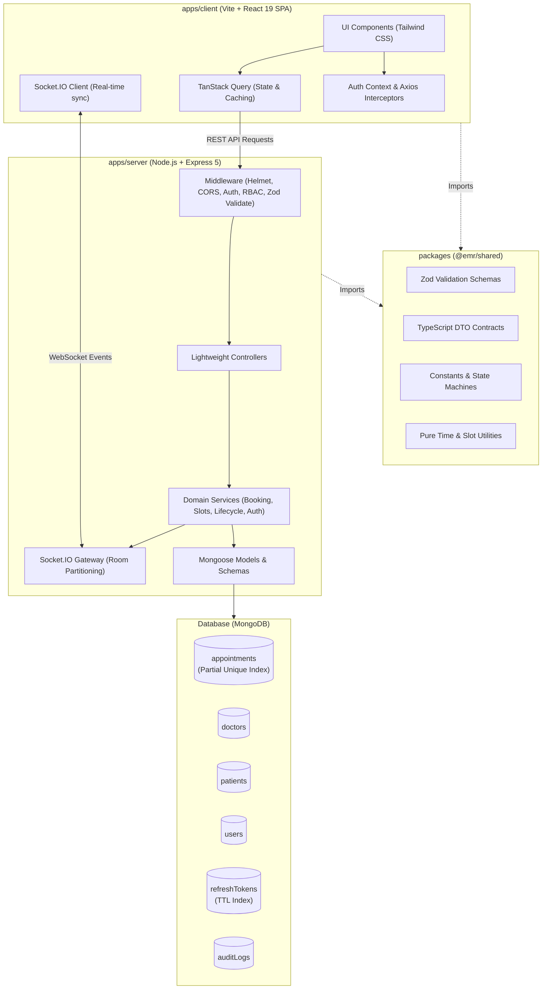
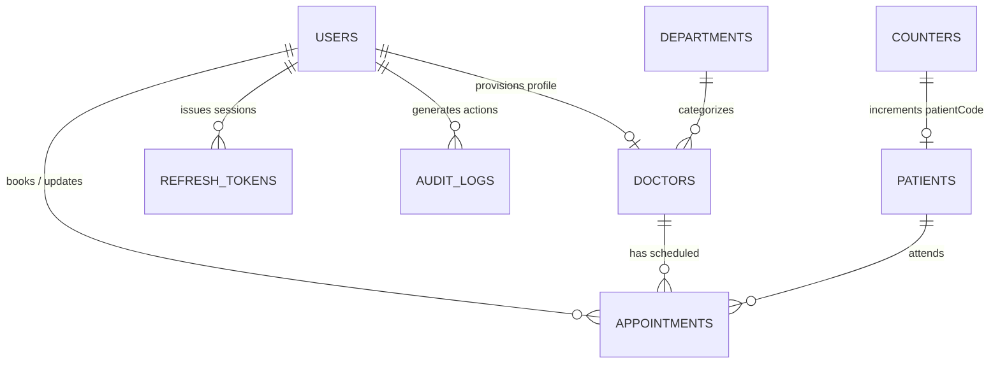

# Enterprise EMR Appointment Management System

> Production-ready Appointment Management module for an Enterprise Electronic Medical Record (EMR) system built with the **MERN Stack** (MongoDB, Express 5, React 19, Node.js) and TypeScript.

[](https://www.typescriptlang.org/)
[](https://nodejs.org/)
[](https://react.dev/)
[](https://expressjs.com/)
[](https://www.mongodb.com/)
[](https://socket.io/)
[](LICENSE)

---

## Table of Contents
- [1. Project Overview](#1-project-overview)
- [2. System Architecture](#2-system-architecture)
- [3. Documentation Directory](#3-documentation-directory)
- [4. Technology Stack](#4-technology-stack)
- [5. Folder Structure](#5-folder-structure)
- [6. Database Design & Schema](#6-database-design--schema)
- [7. API Standards & Endpoints](#7-api-standards--endpoints)
- [8. Concurrency & Double-Booking Safeguards](#8-concurrency--double-booking-safeguards)
- [9. Real-Time WebSockets (Engineering Challenge)](#9-real-time-websockets-engineering-challenge)
- [10. Role-Based Access Control (RBAC)](#10-role-based-access-control-rbac)
- [11. Environment Variables](#11-environment-variables)
- [12. Installation & Setup Instructions](#12-installation--setup-instructions)
- [13. Running the Project](#13-running-the-project)
- [14. Default Seed Accounts & Credentials](#14-default-seed-accounts--credentials)
- [15. Assumptions Made](#15-assumptions-made)
- [16. Known Limitations](#16-known-limitations)
- [17. Future Improvements & Scaling to Millions](#17-future-improvements--scaling-to-millions)
- [18. Submission Details](#18-submission-details)

---

## 1. Project Overview

The **Enterprise EMR Appointment Management System** provides high-reliability clinical scheduling, role-based workflows, and real-time consultation coordination across clinic departments.

### Core Capabilities:
- **Strict Role-Based Access Control (RBAC)**: Enforces clinical boundary separation across **Super Admin**, **Receptionist**, and **Doctor** roles with doctor resource isolation.
- **Dynamic On-Demand Slot Generation**: Algorithmic slot generation supporting multi-session working hours, break interval exclusions (e.g., lunch breaks), configurable slot durations (5–60 min), and past-time exclusion without storing stale slot documents.
- **Race-Proof Concurrency Control**: Guarantees zero double-booking via database-enforced **partial unique compound indexes** combined with ACID multi-document transactions.
- **Real-Time Calendar Synchronization**: Multi-user live updates using **Socket.IO** rooms partitioned by physician and date. Connected clients observe new bookings, cancellations, and status transitions without reloading.
- **Dual-Token Authentication**: Secure JWT authentication with 15-minute access tokens, HTTP-only secure refresh cookies, SHA-256 hashed token storage, and single-use rotation.
- **Dual Patient Intake**: Supports searching existing patients by name, patient ID (`P000001`), or mobile number, as well as atomic intake for new patients during appointment booking.
- **Audit Logging**: Comprehensive, indexed audit trail tracking security events, status transitions, and appointment creations.

---

## 2. System Architecture

The application is structured as an **npm workspace monorepo** separating the domain into three tightly cohesive units:



### Unidirectional Request Lifecycle:
$$\text{HTTP Request} \longrightarrow \text{Zod Validator} \longrightarrow \text{JWT / RBAC} \longrightarrow \text{Controller} \longrightarrow \text{Service} \longrightarrow \text{Mongoose} \longrightarrow \text{DTO Mapper}$$

- **Zero Pass-Through Repositories**: Mongoose models are leveraged directly inside domain services with `.lean()` and targeted projections, maintaining clean code without bloated indirection.
- **DTO Mappers**: Sensitive database internals (`__v`, `passwordHash`, internal tracking flags) are explicitly filtered before sending responses.

---

## 3. Documentation Directory

All detailed technical specifications, database designs, and architectural papers are organized inside the [`docs/`](docs/) directory and root:

| Document | Description |
| :--- | :--- |
| **[`apps/client/README.md`](apps/client/README.md)** | **Frontend Application Guide**: Vite + React 19 SPA architecture, TanStack Query caching, Axios single-flight refresh interceptor, and feature modules. |
| **[`apps/server/README.md`](apps/server/README.md)** | **Backend Service Guide**: Express 5 REST API & Socket.IO server, layered architecture, pure slot engine, and partial unique index concurrency control. |
| **[`ENGINEERING_DECISIONS.md`](../ENGINEERING_DECISIONS.md)** | **Mandatory Assessment Document** *(stored at project root outside repository)*: In-depth answers to all 7 required architectural, schema, concurrency, indexing, security, performance, and scaling questions. |
| **[`docs/api-documentation.md`](docs/api-documentation.md)** | Complete REST & WebSocket API specification: request/response JSON schemas, query filters, error contracts, and RBAC matrix. |
| **[`docs/database-design.md`](docs/database-design.md)** | MongoDB database architecture: Mermaid ER diagram, collection schemas, strategic denormalization analysis, indexing strategy, and sample documents. |
| **[`docs/realtime-architecture.md`](docs/realtime-architecture.md)** | Engineering Challenge reference: Socket.IO implementation, room partitioning strategy (`doctor:${id}:${date}`), sequence diagrams, and TanStack Query cache invalidation. |
| **[`docs/concurrency-and-slot-engine.md`](docs/concurrency-and-slot-engine.md)** | Technical deep-dive into the pure mathematical slot algorithm, break collision detection, partial unique compound indexes, and ACID transaction rollbacks. |

---

## 4. Technology Stack

### Backend
- **Runtime**: Node.js >= 20.0.0
- **Framework**: Express 5.x
- **Database & ODM**: MongoDB with Mongoose 8.x
- **Real-Time Gateway**: Socket.IO 4.x
- **Authentication**: `jsonwebtoken` (JWT), `bcryptjs` (cost factor 12)
- **Validation**: Zod (shared across client and server)
- **Security & Logging**: Helmet, CORS, `express-rate-limit`, Pino (`pino-http`)
- **Unit & Integration Testing**: Vitest, Supertest

### Frontend
- **Framework**: React 19 with TypeScript
- **Bundler**: Vite
- **Styling**: Tailwind CSS
- **Routing**: React Router 7
- **Server State Management**: TanStack Query (React Query)
- **Client Form State**: React Hook Form with `@hookform/resolvers/zod`
- **Real-Time Client**: Socket.IO Client
- **Icons & UI**: Lucide React

### End-to-End Testing & Tooling
- **E2E Testing**: Playwright (covering auth, RBAC, booking lifecycle, real-time sync, and admin provisioning)
- **Linting & Formatting**: Biome
- **Process Orchestration**: Concurrently

---

## 5. Folder Structure

```
emr/
├── apps/
│   ├── client/                      # Vite + React 19 Frontend SPA
│   │   ├── src/
│   │   │   ├── features/
│   │   │   │   ├── appointments/    # Appointment listing, status updates, cancellation
│   │   │   │   ├── auth/            # Login page, auth forms, session state
│   │   │   │   ├── dashboard/       # Role-specific clinical dashboards
│   │   │   │   ├── doctors/         # Doctor provisioning & schedule editors
│   │   │   │   ├── scheduler/       # Interactive slot grid & booking modal
│   │   │   │   └── staff/           # Receptionist staff onboarding & directory
│   │   │   ├── shared/
│   │   │   │   ├── api/             # Axios client with single-flight refresh interceptor
│   │   │   │   ├── components/      # UI components (Buttons, Inputs, Modals, Layout)
│   │   │   │   ├── context/         # AuthContext & Session Provider
│   │   │   │   ├── hooks/           # useDebounce, useToast
│   │   │   │   └── socket/          # Socket.IO client & useRealtime hook
│   │   │   ├── routes/              # AppRoutes with ProtectedRoute & RoleGuard
│   │   │   ├── App.tsx              # Root component
│   │   │   └── main.tsx             # DOM entry point
│   │   ├── README.md                # Frontend SPA documentation
│   │   ├── package.json
│   │   └── vite.config.ts           # Dev proxy (/api, /socket.io -> localhost:3000)
│   │
│   └── server/                      # Express 5 REST & Real-Time Backend
│       ├── src/
│       │   ├── config/              # Environment parser (env.ts), DB connect, constants
│       │   ├── errors/              # Typed domain errors (BaseError, ConflictError, etc.)
│       │   ├── logging/             # Pino logger setup
│       │   ├── middlewares/         # Auth, RBAC, validate, error-handler, rate-limiting
│       │   ├── modules/
│       │   │   ├── appointments/    # Booking, lifecycle, query services, Mongoose model
│       │   │   ├── audit/           # Audit trail logging service & model
│       │   │   ├── auth/            # Auth controller, user & refresh token models
│       │   │   ├── departments/     # Department service, controller & model
│       │   │   ├── doctors/         # Doctor controller, model & staff routes
│       │   │   ├── health/          # Liveness and readiness health checks
│       │   │   ├── patients/        # Patient model, counter model & prefix search
│       │   │   └── slots/           # Pure mathematical slot generation engine
│       │   ├── seed/                # Deterministic seed data script
│       │   ├── sockets/             # Socket.IO initialization & handshake auth
│       │   ├── utils/               # Hash, JWT, API response envelope, Mongo error helpers
│       │   ├── app.ts               # Express application factory
│       │   └── server.ts            # HTTP & Socket.IO server listener
│       ├── README.md                # Backend service documentation
│       ├── tests/                   # Integration and unit test suites
│       └── package.json
│
├── docs/                            # Separable Technical Documentation
│   ├── api-documentation.md         # Full REST API and WebSocket specification
│   ├── database-design.md           # MongoDB schemas, ERD, denormalization & indexes
│   ├── realtime-architecture.md     # Real-time WebSocket architecture & sequence flows
│   └── concurrency-and-slot-engine.md # Slot engine & race condition deep-dive
│
├── packages/                        # Shared Workspace Package (@emr/shared)
│   └── src/
│       ├── constants/               # Roles, appointment statuses, API envelopes
│       ├── schemas/                 # Zod validation schemas (auth, appointment, doctor)
│       ├── types/                   # TypeScript DTOs & response contracts
│       └── utils/                   # Pure time conversion helpers (toMinutes, fromMinutes)
│
├── e2e/                             # Playwright End-to-End Test Suite
│   ├── admin-management.spec.ts
│   ├── appointments-lifecycle.spec.ts
│   ├── auth.spec.ts
│   ├── dashboard.spec.ts
│   ├── rbac.spec.ts
│   ├── realtime-appointments.spec.ts
│   └── scheduling.spec.ts
│
├── package.json                     # Monorepo root workspace configuration
└── playwright.config.ts             # Playwright browser testing configuration
```

---

## 6. Database Design & Schema

The database design uses **strategic denormalization** in `appointments` (`doctorName`, `patientName`, `patientMobile`, `department`) to execute daily front-desk views in a single indexed read without costly `$lookup` aggregations.

### Entity-Relationship Diagram



### Core Collections Overview:
1. **`users`**: System credentials, password hashes (bcrypt, 12 rounds), and RBAC roles (`SUPER_ADMIN`, `RECEPTIONIST`, `DOCTOR`).
2. **`doctors`**: Physician profiles, department references, and weekly schedule templates (working days, multiple sessions, break windows, slot duration).
3. **`patients`**: Patient directory with sequential medical codes (`P000001`), unique mobile phone numbers, and demographics.
4. **`appointments`**: Transactional records with denormalized patient/doctor fields and the `active` boolean flag.
5. **`refreshTokens`**: SHA-256 hashed refresh tokens with MongoDB background **TTL auto-expiration**.
6. **`auditLogs`**: Append-only security audit log recording user, role, action, target entity, and timestamp.
7. **`departments`**: Directory of clinical specialties with unique normalized names.
8. **`counters`**: Atomic sequence counter for patient codes.

👉 *For complete schema tables, indexing specifications, and sample documents, view [`docs/database-design.md`](docs/database-design.md).*

---

## 7. API Standards & Endpoints

All endpoints follow standard REST principles with uniform JSON envelopes and explicit HTTP status codes:

### Success Response Standard:
```json
{
  "success": true,
  "message": "Appointment booked successfully",
  "data": { ... },
  "meta": { "page": 1, "limit": 10, "total": 24, "totalPages": 3 }
}
```

### Error Response Standard:
```json
{
  "success": false,
  "message": "Primary error description",
  "errors": [{ "path": "startTime", "message": "Start time must be formatted as HH:mm" }]
}
```

### Summary of Key API Endpoints:

| Method | Endpoint | Allowed Roles | Description |
| :---: | :--- | :--- | :--- |
| `POST` | `/api/v1/auth/login` | Public | Authenticates credentials, sets HTTP-only refresh cookie, returns access JWT |
| `POST` | `/api/v1/auth/refresh`| Public (Cookie) | Rotates refresh token and issues fresh access token |
| `POST` | `/api/v1/auth/logout` | Authenticated | Revokes refresh token in DB and clears cookie |
| `GET` | `/api/v1/auth/me` | Authenticated | Returns current authenticated user profile |
| `GET` | `/api/v1/doctors` | All Roles | Lists all active physicians and their schedule templates |
| `POST` | `/api/v1/doctors` | `SUPER_ADMIN` | Creates new doctor profile and weekly schedule configuration |
| `PUT` | `/api/v1/doctors/:id`| `SUPER_ADMIN` | Updates doctor profile, schedule, or active status |
| `GET` | `/api/v1/staff/receptionists` | `SUPER_ADMIN` | Lists receptionist accounts |
| `POST` | `/api/v1/staff/receptionists` | `SUPER_ADMIN` | Provisions new receptionist account |
| `GET` | `/api/v1/departments` | All Roles | Lists active clinical departments |
| `GET` | `/api/v1/slots` | All Roles | Computes available/booked slots for a doctor on a specific date |
| `GET` | `/api/v1/patients/search` | `SUPER_ADMIN`, `RECEPTIONIST` | Prefix search across patient name, code, or mobile |
| `POST` | `/api/v1/appointments` | `SUPER_ADMIN`, `RECEPTIONIST` | Books appointment (existing or new patient) with concurrency locks |
| `GET` | `/api/v1/appointments` | All Roles | Paginated appointment list (Doctors automatically scoped to self) |
| `GET` | `/api/v1/appointments/:id` | All Roles | Retrieves appointment details (Doctor ownership enforced) |
| `PUT` | `/api/v1/appointments/:id` | All Roles | Updates appointment purpose or doctor consultation notes |
| `DELETE`| `/api/v1/appointments/:id` | `SUPER_ADMIN`, `RECEPTIONIST` | Cancels appointment; releases slot for immediate rebooking |
| `POST` | `/api/v1/appointments/:id/arrive` | `SUPER_ADMIN`, `RECEPTIONIST` | Transitions status from `SCHEDULED` $\to$ `ARRIVED` |
| `POST` | `/api/v1/appointments/:id/complete`| `SUPER_ADMIN`, `DOCTOR` | Transitions status from `ARRIVED` $\to$ `COMPLETED` |
| `GET` | `/health` & `/api/v1/health` | Public | Liveness probe returning server uptime and DB status |

👉 *For exhaustive documentation with full request/response schemas, view [`docs/api-documentation.md`](docs/api-documentation.md).*

---

## 8. Concurrency & Double-Booking Safeguards

Double-booking is prevented using a **multi-layer defense strategy**:

1. **In-Memory Slot Engine**: Validates that the requested time slot mathematically exists in the doctor's weekly schedule template and does not overlap configured breaks or past hours.
2. **ACID Multi-Document Transactions**: Booking for a new patient creates both the `Patient` document and the `Appointment` document inside a MongoDB transaction (`session.startTransaction()`). If the appointment creation fails, the new patient record is cleanly rolled back.
3. **Storage-Level Partial Unique Index**:
   ```ts
   appointmentSchema.index(
     { doctor: 1, date: 1, startTime: 1 },
     { unique: true, partialFilterExpression: { active: true } }
   );
   ```
   Only active appointments hold the unique constraint. When an appointment is cancelled, `active` is set to `false`, releasing the slot from the index so it can be rebooked immediately.
4. **Collision Translation**: If two users attempt to book the exact same slot at the identical millisecond, WiredTiger's write lock ensures exactly one succeeds. The losing request throws `E11000` or `WriteConflict`, which my error handler transforms into a user-friendly HTTP 409 `SlotConflictError` (`"The YYYY-MM-DD HH:mm slot was just booked by someone else"`).

👉 *For detailed concurrency workflows and conflict tests, view [`docs/concurrency-and-slot-engine.md`](docs/concurrency-and-slot-engine.md).*

---

## 9. Real-Time WebSockets (Engineering Challenge)

To fulfill the assessment's **Engineering Challenge**, real-time synchronization is implemented via **Socket.IO**:

- **Targeted Room Partitioning**: Sockets subscribe to rooms keyed by doctor and date (`doctor:${doctorId}:${date}`). This avoids broadcasting irrelevant doctor schedules to all users.
- **Service-Level Event Triggers**: The appointment service dispatches events (`appointment:created`, `appointment:updated`, `appointment:cancelled`) immediately after successful database operations.
- **Client Cache Invalidation**: The frontend `useRealtimeScheduler` hook catches incoming events and invalidates TanStack Query keys (`['slots', doctorId, date]` and `['appointments']`), refreshing the slot grid without full page reloads.
- **Handshake Authentication**: Socket connections must supply a valid JWT access token during connection handshake; forged or expired tokens are rejected immediately.

👉 *For sequence diagrams and socket event contracts, view [`docs/realtime-architecture.md`](docs/realtime-architecture.md).*

---

## 10. Role-Based Access Control (RBAC)

The system enforces three distinct clinical roles:

| Feature / Responsibility | Super Admin | Receptionist | Doctor |
| :--- | :---: | :---: | :---: |
| Onboard Physicians & Set Schedules | ✅ | ❌ | ❌ |
| Create Receptionist Accounts | ✅ | ❌ | ❌ |
| Access Clinic-Wide Dashboards | ✅ | ✅ | ❌ (Own only) |
| Search Patient Records | ✅ | ✅ | ❌ |
| Book & Cancel Appointments | ✅ | ✅ | ❌ |
| Mark Patient as Arrived | ✅ | ✅ | ❌ |
| Update Patient Purpose | ✅ | ✅ | ❌ |
| View Assigned Appointments | ✅ (All) | ✅ (All) | ✅ (Strictly Self) |
| Record Consultation Notes | ✅ | ❌ | ✅ (Own Patients) |
| Complete Consultation (`ARRIVED` $\to$ `COMPLETED`) | ✅ | ❌ | ✅ (Own Patients) |

*Doctor resource isolation is enforced at the service layer: if Doctor A queries or updates Doctor B's appointment ID, the server returns 404 Not Found to prevent ID enumeration.*

---

## 11. Environment Variables

Create `.env` inside `apps/server/` based on `.env.example`:

### Server Environment Variables (`apps/server/.env`)
| Variable | Required | Default | Description |
| :--- | :---: | :---: | :--- |
| `NODE_ENV` | No | `development` | Runtime environment (`development`, `test`, `production`) |
| `PORT` | No | `3000` | Port for Express HTTP & WebSocket server |
| `MONGO_URI` | **Yes** | `mongodb://localhost:27017/emr` | MongoDB connection string (Replica set or standalone) |
| `JWT_ACCESS_SECRET` | **Yes** | — | Cryptographic secret for signing access tokens (min 32 chars) |
| `JWT_REFRESH_SECRET`| **Yes** | — | Cryptographic secret for signing refresh tokens (min 32 chars) |
| `JWT_ACCESS_TTL` | No | `15m` | Access token time-to-live string (e.g. `15m`) |
| `JWT_REFRESH_TTL` | No | `7d` | Refresh token time-to-live string (e.g. `7d`) |
| `CLIENT_ORIGIN` | No | `http://localhost:5173` | Allowed frontend origin for CORS and cookies |
| `LOG_LEVEL` | No | `info` | Pino log verbosity (`fatal`, `error`, `warn`, `info`, `debug`) |

### Client Environment Variables (`apps/client/.env`)
*Vite automatically proxies `/api` and `/socket.io` to `http://localhost:3000` during development (configured in `vite.config.ts`), so no manual `.env` file is required for local client development.*

---

## 12. Installation & Setup Instructions

### Prerequisites:
- **Node.js**: Version `>= 20.0.0` (check with `node -v`)
- **npm**: Version `>= 10.0.0` (check with `npm -v`)
- **MongoDB**: Version `>= 6.0` (running locally at `mongodb://localhost:27017` or via MongoDB Atlas URI)

### Step-by-Step Installation:

1. **Clone the Repository**:
   ```bash
   git clone https://github.com/mohammedbilalns/emr.git
   cd emr
   ```

2. **Install Workspace Dependencies**:
   Installs root, server, client, shared packages, and developer tools in one command:
   ```bash
   npm install
   ```

3. **Configure Server Environment**:
   ```bash
   cp apps/server/.env.example apps/server/.env
   ```
   *Edit `apps/server/.env` if your MongoDB URI, port, or JWT secrets differ from defaults.*

4. **Seed the Database**:
   Populates Super Admin, Receptionist, sample Doctors (with the assessment's example schedules), clinical departments, patients, and test appointments:
   ```bash
   npm run seed
   ```

---

## 13. Running the Project

### Start Backend and Frontend Concurrently:
Run both the Express API and Vite React frontend concurrently with a single command from the project root:
```bash
npm run dev
```

### Access Points & URLs:
- **Frontend SPA**: [http://localhost:5173](http://localhost:5173) (Interactive client interface)
- **Backend REST API**: [http://localhost:3000/api/v1](http://localhost:3000/api/v1) (API root)
- **Liveness & Readiness Health Probe**: [http://localhost:3000/health](http://localhost:3000/health) (Returns `{ status: "UP", database: "CONNECTED" }`)
- **WebSocket Gateway**: `ws://localhost:3000/socket.io` (Real-time updates)

### Run Services Individually:
If you prefer running server and client in separate terminal windows:
```bash
# Terminal 1: Backend Server (runs on port 3000 with tsx watch mode)
npm run dev:api

# Terminal 2: Frontend Client (runs on port 5173 with Vite dev proxy)
npm run dev:web
```

### Additional Scripts:
```bash
# Provision a new clinical department via CLI
npm run add:department -- "Dermatology"

# Code Quality & Linting (Biome)
npm run lint          # Run Biome checks across all workspaces
npm run lint:fix      # Automatically fix formatting and lint issues

# TypeScript Strict Typechecking
npm run typecheck     # Runs tsc --noEmit across server and client workspaces

# Test Suites
npm test              # Run Vitest unit & integration tests
npm run test:e2e      # Run Playwright end-to-end browser tests

# Production Build
npm run build         # Compiles server (esbuild) and client (Vite bundle)
```

---

## 14. Database Seeding & Login Verification Guide

Running `npm run seed` sets up a deterministic testing environment with pre-configured accounts, physicians, departments, and sample appointments.

### Pre-Configured Test Accounts:

| Role | Name | Email | Password | Schedule / Department Details |
| :--- | :--- | :--- | :--- | :--- |
| **Super Admin** | Super Admin | `admin@emr.local` | `Admin@12345` | System administrator with global privileges |
| **Receptionist**| Amy Pond | `receptionist@emr.local` | `Recept@12345` | Front desk intake & booking staff |
| **Doctor** | Dr. Sarah Chen | `sarah.chen@emr.local` | `Doctor@12345` | **Cardiology** (Mon–Fri, 09:00–12:00 & 13:00–17:00, lunch break 12:00–13:00, 15m slots) |
| **Doctor** | Dr. James Wilson | `james.wilson@emr.local` | `Doctor@12345` | **Neurology** (Mon–Sat, 09:00–13:00, morning break 10:30–10:45, 30m slots) |

---

### Step-by-Step Login & Feature Verification

Follow these walkthrough steps to test role boundaries, slot generation, real-time sync, and double-booking prevention:

#### 1. Verify Super Admin Role (`admin@emr.local` / `Admin@12345`)
1. Open [http://localhost:5173](http://localhost:5173) and log in with Super Admin credentials.
2. **Dashboard**: Observe clinic-wide appointment statistics and clinical metrics.
3. **Doctor Management**: Navigate to `/doctors` and click **"Add Doctor"**. Provision a physician with custom working hours and breaks.
4. **Staff Management**: Navigate to `/staff` and onboard a new receptionist account.
5. **Full Visibility**: View all appointments across every clinical department.

#### 2. Verify Receptionist Role (`receptionist@emr.local` / `Recept@12345`)
1. Log out or open an Incognito window and log in as `receptionist@emr.local`.
2. **Scheduler View**: Navigate to `/scheduler`.
   - Select **Dr. Sarah Chen** and choose tomorrow's date.
   - Observe that slots from **12:00 to 13:00 (Lunch Break)** are completely excluded by the pure slot generator.
3. **Existing Patient Booking**:
   - Click an available slot (e.g. `10:00`).
   - In the search bar, type `"Alice"` or `"P000001"` — note the debounced autocomplete search.
   - Select **Alice Johnson** and confirm booking.
4. **New Patient Intake (Atomic)**:
   - Click another available slot.
   - Toggle to **"New Patient"** and enter name, mobile phone number, and gender.
   - Click **"Book Appointment"** — observe atomic patient record creation and appointment scheduling.
5. **Clinical Workflow**:
   - Go to `/appointments`.
   - Click **"Mark Arrived"** on a scheduled appointment — status transitions to `ARRIVED`.
   - Cancel an appointment — verify status transitions to `CANCELLED` and the time slot is immediately released for rebooking.

#### 3. Verify Doctor Role (`sarah.chen@emr.local` / `Doctor@12345`)
1. Log in as `sarah.chen@emr.local`.
2. **Resource Isolation**: Navigate to `/appointments`. Notice that **only Dr. Sarah Chen's appointments are displayed**. Dr. James Wilson's appointments are strictly isolated by backend authorization.
3. **Consultation Notes**: Click on an assigned appointment, enter clinical diagnosis notes, and save.
4. **Complete Consultation**: Click **"Complete"** on an `ARRIVED` patient visit — status transitions to `COMPLETED`. (Notice receptionists are forbidden from completing clinical consultations).

#### 4. Verify Real-Time WebSockets (Engineering Challenge)
1. Open two browser windows side by side at [http://localhost:5173](http://localhost:5173):
   - **Window 1**: Logged in as Receptionist (`receptionist@emr.local`), viewing `/scheduler` for Dr. Sarah Chen.
   - **Window 2**: Logged in as Super Admin (`admin@emr.local`) or in Incognito, viewing the same scheduler page.
2. In **Window 1**, book an available slot (e.g. `11:00`).
3. **Watch Window 2**: Notice that the `11:00` slot immediately turns red (**"BOOKED"**) in real-time **without refreshing the page**.
4. In **Window 1**, go to `/appointments` and cancel that appointment.
5. **Watch Window 2**: The `11:00` slot immediately turns green (**"AVAILABLE"**) in real-time.

#### 5. Verify Double-Booking Prevention (Concurrency Guard)
1. In two separate browser windows on the scheduler page, select the exact same doctor, date, and available slot.
2. Open the booking modal in both windows.
3. Submit the booking in both windows simultaneously.
4. Exactly **one** booking succeeds with HTTP 201 Created. The second request is rejected by WiredTiger's partial unique compound index, returning HTTP 409 Conflict with the alert:
   > *"The YYYY-MM-DD HH:mm slot was just booked by someone else — refreshing availability."*


---

## 15. Assumptions Made

1. **Single-Timezone Clinic**: All clinic scheduling operates under a unified local timezone. Dates are modeled as `YYYY-MM-DD` and times as `HH:mm` strings. This eliminates timezone drift and daylight savings offsets.
2. **Dynamic Slot Calculation**: Consultation slots are calculated dynamically on-demand from weekly schedule templates rather than stored as physical documents in MongoDB.
3. **Sequence Gap Tolerance**: Patient medical codes (`P000001`) use an atomic MongoDB counter outside transactions. Sequence gaps caused by cancelled or aborted new-patient intakes are acceptable in clinical audit logs.
4. **Clinical Status Transition Workflow**: State transitions strictly follow `SCHEDULED` $\to$ `ARRIVED` $\to$ `COMPLETED` or `CANCELLED`. Direct completion without patient arrival is prevented.

---

## 16. Known Limitations

- **Single Clinic Scope**: Designed for a single clinic / hospital network sharing one timezone. Multi-timezone scheduling would require storing clinic timezone offsets per facility.
- **Single Slot Booking**: Bookings are reserved one slot at a time. Multi-slot appointments (e.g., 60-minute double surgery blocks) require booking consecutive slots.
- **Audit Log Growth**: Audit logs are currently appended to a standard capped/uncapped collection; long-term production deployment would require an automated archival pipeline.

---

## 17. Future Improvements & Scaling to Millions

As detailed in [`ENGINEERING_DECISIONS.md`](../ENGINEERING_DECISIONS.md), scaling this architecture to tens of millions of records would involve:

1. **Compound Sharding**: Shard the `appointments` collection on `{ date: 1, doctor: 1 }` to concentrate 95%+ of active writes and daily reads on current shards.
2. **Tiered Storage Archival**: Automatically migrate appointments older than 6–12 months into compressed cold storage (e.g. MongoDB Atlas Online Archive on S3/Parquet).
3. **Read/Write Splitting**: Route search queries, history lookups, and reporting dashboards to MongoDB secondary read replicas (`secondaryPreferred`).
4. **Redis Slot Bitmasks**: Cache daily doctor slot matrices in Redis bitfields, using Lua scripts for atomic test-and-set slot reservation before MongoDB insertion.
5. **Asynchronous Message Queue**: Offload email/SMS notifications, external EMR sync, and audit log processing to BullMQ or Apache Kafka worker pools.

---

## 18. Submission Details

- **Git Repository**: [https://github.com/mohammedbilalns/emr.git](https://github.com/mohammedbilalns/emr.git)
- **Primary Branch**: `dev` / `main`
- **Assessment**: MERN Stack Developer Assessment — Enterprise EMR Appointment Management System
- **Engineering Decisions Reference**: [`ENGINEERING_DECISIONS.md`](../ENGINEERING_DECISIONS.md) *(stored at project root outside repository)*
- **API Documentation**: [`docs/api-documentation.md`](docs/api-documentation.md)
- **Database Architecture**: [`docs/database-design.md`](docs/database-design.md)
- **Real-Time WebSockets Architecture**: [`docs/realtime-architecture.md`](docs/realtime-architecture.md)
- **Concurrency & Slot Engine Deep Dive**: [`docs/concurrency-and-slot-engine.md`](docs/concurrency-and-slot-engine.md)
