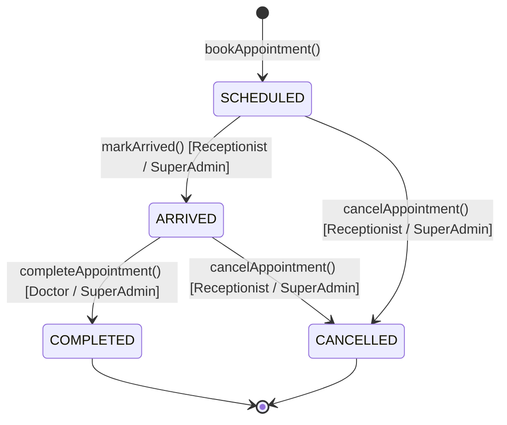

# Concurrency Control & Slot Engine Deep Dive

Comprehensive analysis of the Dynamic Slot Generation Algorithm, Race-Condition Safeguards, and Double-Booking Prevention.

---

## 1. Dynamic Slot Engine Mechanics

The slot engine is implemented as a **pure mathematical generator function** (`generateSlots` in `apps/server/src/modules/slots/slot.service.ts`). It computes discrete consultation intervals without performing database writes.

### 1.1 Pure Algorithm Overview

```
Input: (Doctor Schedule, Date "YYYY-MM-DD", Current Reference Time)
  │
  ├─ 1. Check Working Days
  │     Extract day of week (0..6) from Date.
  │     If day is not in schedule.workingDays ──► Return []
  │
  ├─ 2. Step Through Session Windows
  │     Convert session start/end strings to minutes since midnight (e.g. "09:00" ──► 540).
  │     For each window: t = start; t + slotDuration <= end; t += slotDuration:
  │        - Candidate slot = [t, t + slotDuration)
  │        - Check overlap against doctor breaks
  │        - If no overlap: Push { startTime, endTime } to slots array
  │
  ├─ 3. Filter Past Dates & Elapsed Time Slots
  │     If date < today ──► Return []
  │     If date == today:
  │        - Calculate current minutes since midnight: nowMinutes = now.hours * 60 + now.minutes
  │        - Filter out any slot where toMinutes(slot.startTime) <= nowMinutes
  │
  └─ Return validated candidate slots
```

### 1.2 Mathematical Break Overlap Condition
A candidate slot interval $[t_{\text{start}}, t_{\text{end}})$ overlaps a break $[b_{\text{start}}, b_{\text{end}})$ if and only if:
$$b_{\text{start}} < t_{\text{end}} \quad \text{AND} \quad t_{\text{start}} < b_{\text{end}}$$

This guarantees:
- Breaks spanning sessions (e.g. lunch 12:00–13:00) are fully omitted.
- Mid-session breaks (e.g. tea 10:30–10:45) cleanly divide sessions without generating fractional or clipped slots.
- Generated slots are contiguous and strictly non-overlapping.

### 1.3 Slot Availability Retrieval
When a user requests `GET /api/v1/slots?doctorId=...&date=...`:
1. Theoretical slots are generated in memory via `generateSlots`.
2. A single indexed query executes against `appointments`:
   ```ts
   const booked = await Appointment.find({ doctor: doctorId, date, active: true })
     .select("startTime -_id")
     .lean();
   ```
3. Booked start times populate an in-memory `Set` in $O(1)$ lookup time:
   ```ts
   const bookedSet = new Set(booked.map(a => a.startTime));
   return generated.map(s => ({
     startTime: s.startTime,
     endTime: s.endTime,
     status: bookedSet.has(s.startTime) ? "BOOKED" : "AVAILABLE"
   }));
   ```

---

## 2. Concurrency Handling & Double-Booking Prevention

### 2.1 The Double-Booking Race Condition

In a multi-user clinical environment, two receptionists may simultaneously click "Book" for the same doctor at 09:30 on the same date:

```
Timeline:
Time    Receptionist A                       Receptionist B
─────────────────────────────────────────────────────────────────────────────
T1      Submits booking (09:30)              Submits booking (09:30)
T2      Read checks pass: slot available     Read checks pass: slot available
T3      Begins document write                Begins document write
T4      ???                                  ???
```

If double-booking prevention relies solely on application-level read checks (`find({ startTime: "09:30" }) === null`), **both writes will succeed**, resulting in two patients arriving for the same consultation time.

---

### 2.2 Storage-Level Partial Unique Index

To make double-booking physically impossible at the database engine level, I enforce a **compound partial unique index** in MongoDB:

```ts
// apps/server/src/modules/appointments/appointment.model.ts
appointmentSchema.index(
  { doctor: 1, date: 1, startTime: 1 },
  { unique: true, partialFilterExpression: { active: true } }
);
```

#### Why a Partial Index?
- In MongoDB, unique indexes reject duplicate values across all indexed keys.
- If I used `{ doctor: 1, date: 1, startTime: 1 }` without a partial filter, cancelling an appointment would retain the record in the unique index, **permanently preventing anyone from ever re-booking that slot**.
- MongoDB partial filter expressions do **not** support negative operators like `{ status: { $ne: "CANCELLED" } }`.
- Therefore, I introduce a boolean gate flag: `active: true`.
- When an appointment is created, `active` is set to `true` (enforcing uniqueness).
- When an appointment is cancelled, `active` is updated to `false`. **The document immediately drops out of the partial index**, releasing the unique constraint and allowing the exact same slot to be booked again.

---

### 2.3 Transaction Management & Rollback Strategy

```ts
// apps/server/src/modules/appointments/services/appointment-booking.service.ts
export async function bookAppointment(body, actor) {
  // 1. Verify slot exists on doctor schedule
  // 2. Start session and transaction (if replica set supported)
  const session = supportsTransactions() ? await mongoose.startSession() : null;

  try {
    // 3. Create or resolve Patient
    // 4. Create Appointment document
    const [appointment] = await Appointment.create([payload], { session });

    // 5. Commit transaction
    if (session) await session.commitTransaction();

    // 6. Emit real-time events & audit logs
    emitAppointmentCreated(...);
    return toAppointmentDto(appointment);
  } catch (error) {
    // 7. Abort transaction on any collision
    if (session) await session.abortTransaction();
    else if (newPatientCreated) await Patient.deleteOne({ _id: patientId });

    // 8. Map database collision to standard HTTP 409
    if (isDuplicateKey(error, "startTime")) {
      throw new SlotConflictError({ date: body.date, startTime: body.startTime });
    }
    if (isWriteConflict(error)) {
      throw new SlotConflictError({ date: body.date, startTime: body.startTime });
    }
    throw error;
  }
}
```

#### Multi-Deployment Compatibility:
- **MongoDB Replica Sets & Atlas**: Utilizes ACID multi-document transactions (`session.startTransaction()`). Any conflict cleanly rolls back both the newly registered patient and the appointment.
- **Standalone MongoDB Instances**: Standard development environments without replica sets gracefully bypass multi-document transactions and rely on the database partial unique index, backed by compensating deletion logic (`Patient.deleteOne`) if the appointment insert fails.

---

## 3. Status Transition State Machine

Appointments follow a strictly enforced clinical workflow:



### Transition Rules:
| Current Status | Allowed Target Statuses | Disallowed Transitions |
| :--- | :--- | :--- |
| `SCHEDULED` | `ARRIVED`, `CANCELLED` | `COMPLETED` (Patient must arrive before consultation) |
| `ARRIVED` | `COMPLETED`, `CANCELLED` | `SCHEDULED` (Cannot un-arrive) |
| `COMPLETED` | *Terminal state* (None) | Cannot transition out of `COMPLETED` |
| `CANCELLED` | *Terminal state* (None) | Cannot transition out of `CANCELLED` |

### Optimistic Concurrency on Status Transitions:
To prevent race conditions when two users attempt conflicting state changes simultaneously:
```ts
const updated = await Appointment.findOneAndUpdate(
  { _id: id, status: currentStatus }, // Optimistic guard
  { $set: { status: targetStatus, updatedBy: actor.id } },
  { returnDocument: "after" }
);

if (!updated) {
  throw new ConflictError("Appointment was changed by another user — please retry");
}
```
If User A marks the appointment as `CANCELLED` while User B concurrently attempts to mark it `ARRIVED`, User B's optimistic query fails to match `{ status: "SCHEDULED" }` and returns a clean HTTP 409 conflict.
