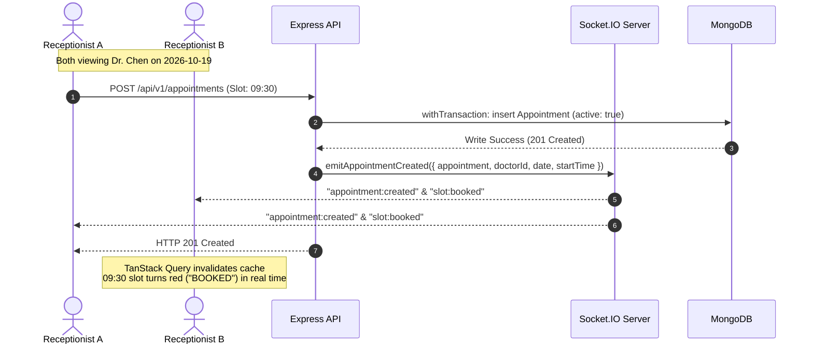
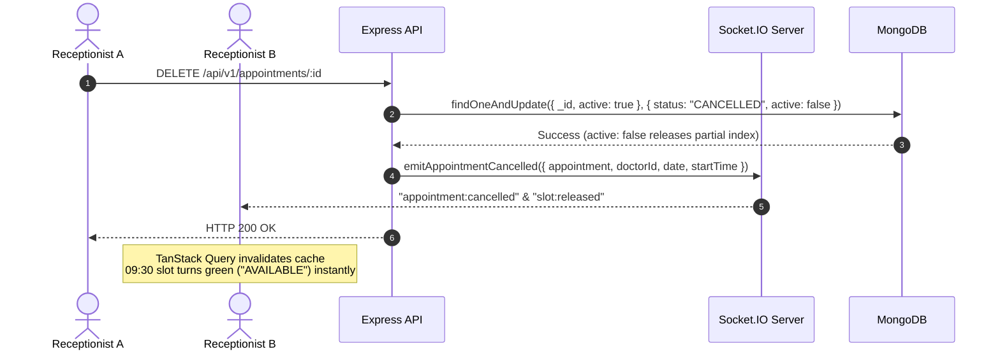

# Real-Time Architecture & WebSocket Specification

Implementation details and architectural design for the assessment's **Engineering Challenge: Real-Time Appointment Updates using WebSockets (Socket.IO)**.

---

## 1. Challenge Overview & Problem Statement

In a multi-user clinical environment, receptionists and physicians concurrently view and book appointments. Without real-time synchronization:
- Stale slot grids cause users to attempt booking slots that were already reserved, triggering unexpected 409 errors.
- Receptionists must manually refresh pages to observe arrival updates and doctor schedule changes.
- Physicians cannot see live updates when receptionists mark patients as arrived in the waiting area.

**Objective**: Ensure that whenever an appointment is **Created**, **Updated**, or **Cancelled**, all connected users viewing that doctor's schedule receive instant live updates without manually reloading the browser.

---

## 2. Real-Time Architecture

The system uses **Socket.IO** attached to the Express HTTP server, sharing the same host port:

```
┌────────────────────────────────┐         ┌────────────────────────────────┐
│ Receptionist Browser (Client A)│         │ Doctor / Staff (Client B)      │
└───────────────┬────────────────┘         └───────────────┬────────────────┘
                │                                          │
                │ 1. scheduler:join { doctorId, date }     │ 2. scheduler:join { doctorId, date }
                │    (Subscribes to room channel)          │    (Subscribes to room channel)
                ▼                                          ▼
┌───────────────────────────────────────────────────────────────────────────┐
│                        Node.js / Express Server                           │
│  ┌─────────────────────────────────────────────────────────────────────┐  │
│  │                    Socket.IO Server Gateway                         │  │
│  │  - Handshake Authentication Middleware (Verifies JWT access token)  │  │
│  │  - Room Partitioning: `doctor:${doctorId}:${date}`                  │  │
│  └─────────────────────────────────────────────────────────────────────┘  │
│                                      ▲                                    │
│                                      │ 4. Service Emits Event             │
│  ┌───────────────────────────────────┴─────────────────────────────────┐  │
│  │                     Appointment Domain Service                      │  │
│  │  - bookAppointment()   ──► emitAppointmentCreated()                 │  │
│  │  - transitionStatus()  ──► emitAppointmentUpdated() / Cancelled()   │  │
│  │  - updateAppointment() ──► emitAppointmentUpdated()                 │  │
│  └─────────────────────────────────────────────────────────────────────┘  │
└──────────────────────────────────────┬────────────────────────────────────┘
                                       │
                                       │ 5. Broadcast to room `doctor:${doctorId}:${date}`
                                       ▼
                     ┌──────────────────────────────────┐
                     │ Client B Receives Event          │
                     │ - Invalidate TanStack Query:     │
                     │   `['slots', doctorId, date]`    │
                     │   `['appointments']`             │
                     │ - UI re-renders slot immediately │
                     └──────────────────────────────────┘
```

---

## 3. Room Partitioning Strategy

To prevent unnecessary network bandwidth consumption and client processing overhead, the server does **not** broadcast events to a global channel.

Instead, rooms are partitioned by doctor ID and date:
$$\text{Room Channel} = \texttt{doctor:}\langle\text{doctorId}\rangle\texttt{:}\langle\text{date}\rangle$$
*(e.g., `doctor:670c5b369324c5820ab05ef2:2026-10-19`)*

### Channel Lifecycle:
1. When a user navigates to the Appointment Scheduler and selects Dr. Sarah Chen for `2026-10-19`, the frontend emits:
   ```ts
   socket.emit("scheduler:join", { doctorId, date });
   ```
2. The server adds the client's socket connection to that room.
3. If the user changes the date picker or selects a different physician, the client emits `scheduler:leave` for the previous room and `scheduler:join` for the new room.
4. When an appointment is booked for that physician on that date, the server emits targeted events exclusively to sockets within `doctor:${doctorId}:${date}`.

---

## 4. Sequence Diagrams

### 4.1 Concurrent Appointment Booking & Live Slot Invalidation



### 4.2 Cancellation & Instant Slot Release



---

## 5. Security & Authentication Handshake

Real-time WebSocket connections enforce authentication matching REST endpoints:
1. The client supplies the current JWT access token in the `auth` handshake object:
   ```ts
   const socket = io(SERVER_URL, {
     auth: { token: getAccessToken() },
     transports: ["websocket", "polling"],
   });
   ```
2. Server connection middleware (`socket.server.ts`) validates the token via `verifyAccessToken`:
   ```ts
   io.use((socket, next) => {
     const token = socket.handshake.auth.token;
     if (!token) return next(new Error("Missing access token"));
     try {
       const payload = verifyAccessToken(token);
       socket.data.user = payload;
       next();
     } catch (err) {
       next(new Error("Invalid or expired token"));
     }
   });
   ```
3. If an access token expires or is forged, the socket connection is rejected immediately. When the client refreshes its access token, the socket client automatically reconnects with the fresh credentials.

---

## 6. Frontend Integration & TanStack Query Synchronization

On the client, the `useRealtime` hook orchestrates room subscriptions and cache invalidation:

```ts
// apps/client/src/shared/socket/use-realtime.ts
export function useRealtimeScheduler(doctorId?: string, date?: string) {
  const queryClient = useQueryClient();

  useEffect(() => {
    if (!doctorId || !date) return;

    joinSchedulerRoom(doctorId, date);

    const onAppointmentCreated = () => {
      queryClient.invalidateQueries({ queryKey: ["slots", doctorId, date] });
      queryClient.invalidateQueries({ queryKey: ["appointments"] });
    };

    const onAppointmentUpdated = () => {
      queryClient.invalidateQueries({ queryKey: ["slots", doctorId, date] });
      queryClient.invalidateQueries({ queryKey: ["appointments"] });
    };

    const onAppointmentCancelled = () => {
      queryClient.invalidateQueries({ queryKey: ["slots", doctorId, date] });
      queryClient.invalidateQueries({ queryKey: ["appointments"] });
    };

    socket.on("appointment:created", onAppointmentCreated);
    socket.on("appointment:updated", onAppointmentUpdated);
    socket.on("appointment:cancelled", onAppointmentCancelled);

    return () => {
      leaveSchedulerRoom(doctorId, date);
      socket.off("appointment:created", onAppointmentCreated);
      socket.off("appointment:updated", onAppointmentUpdated);
      socket.off("appointment:cancelled", onAppointmentCancelled);
    };
  }, [doctorId, date, queryClient]);
}
```

### Why Query Invalidation Over Manual State Patching?
- **Zero Inconsistency**: Rather than manually appending or mutating complex deeply-nested appointment arrays in client memory, invalidating queries prompts TanStack Query to perform a micro-refetch of the current view.
- **Deduplication**: If multiple socket events fire within milliseconds, TanStack Query batches refetches into a single network round-trip.
